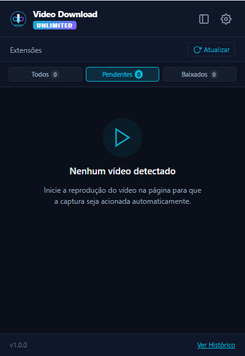
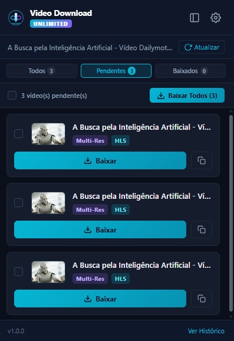
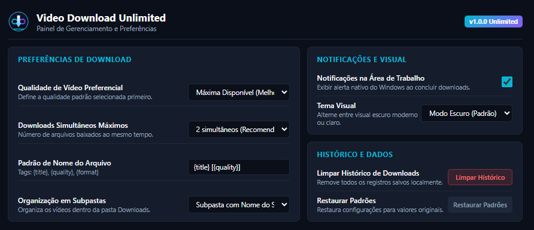
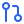

<div align="center">

# Video Download Unlimited

**A extensão definitiva para captura, processamento e download de vídeos e áudios na web.**  
*Baseada na especificação Google Chrome Manifest V3, 100% in-browser, com motor WebAssembly (LibAV/FFmpeg) e zero dependências externas.*

[](#)
[](#)
[](LICENSE)
[](#)
[](#)

</div>

---

##  Visão Geral

O **Video Download Unlimited** é uma extensão avançada e moderna para navegadores da família Chromium (Google Chrome, Brave, Microsoft Edge, Opera, Vivaldi, etc.). Ela detecta e captura transmissões de mídia complexas (como fluxos segmentados HLS/m3u8, inclusive criptografados com AES-128, e DASH) diretamente no tráfego da rede e na árvore DOM das páginas.

Diferente de extensões legadas que exigem a instalação de executáveis auxiliares (como Python, scripts de terminal ou instaladores externos no computador), o **Video Download Unlimited** roda um motor completo **FFmpeg/LibAV compilado em WebAssembly (WASM)** diretamente em um documento *Offscreen* do navegador, empacotando os segmentos em arquivos MP4 prontos ou extraindo áudio em MP3 instantaneamente.

---

##  Demonstração da Interface

<div align="center">

| Popup Principal | Detecção e Download em Ação |
| :---: | :---: |
|  |  |

<br/>

### Painel de Configurações & Gerenciamento Avançado


</div>

---

##  Principais Funcionalidades

-  **Zero Dependências Externas**: Não requer Node.js, Python, FFmpeg instalado no sistema operacional ou softwares companheiros. Tudo roda dentro do sandbox do navegador.
-  **Sniffing de Rede & Detector DOM**: Intercepta solicitações de rede via `chrome.webRequest` e monitora elementos `<video>`, `<audio>` e tags de mídia no DOM com retentativa inteligente e backoff exponencial.
-  **Suporte Completo a HLS (.m3u8) & AES-128**: Baixa múltiplos segmentos `.ts`, descriptografa fragmentos criptografados com chave AES-128 e realiza o muxing direto para contêiner MP4.
-  **Extração Direta de Áudio (MP3 / AAC)**: Permite extrair a faixa sonora de qualquer vídeo com 1 clique sem perda de qualidade.
-  **Captura Automática de Thumbnails**: Gera miniaturas reais dos vídeos através de tags `og:image`, posters do player ou snapshot instantâneo via HTML5 Canvas.
-  **Painel Lateral Nativo (Chrome Side Panel)**: Acompanhe downloads ativos e mídias detectadas sem que a janela se feche ao clicar fora.
-  **Interface Moderna (Dark Mode & Glassmorphism)**: Interface responsiva em modo escuro, com visualização de resolução, formato, tamanho estimado e filtros rápidos (Todos, Vídeo, Áudio, HLS).
-  **Fila de Downloads Inteligente**: Controle de concorrência (`maxConcurrent`), ordenação por prioridade e prevenção de sobrecarga na largura de banda.
-  **Organização Automática de Arquivos**: Salva downloads organizados em subpastas por nome de domínio (`Downloads/Video Download Unlimited/{dominio}/`) ou por data.
-  **Notificações Nativas do Sistema**: Alerta sonoro e visual integrado ao sistema operacional quando os downloads são finalizados.
-  **Privacidade Absoluta (100% Local)**: Nenhum dado de navegação, histórico, cookie ou mídia é enviado para servidores de terceiros.

---

##  Arquitetura Técnica

```
                    ┌──────────────────────────────────────────────┐
                    │               PÁGINA WEB                     │
                    │   <video>, <iframe>, requests de rede...     │
                    └───────┬──────────────────────────────┬───────┘
                            │ (Injeção DOM)                │ (Sniffing HTTP)
                            ▼                              ▼
                 ┌──────────────────────┐      ┌──────────────────────┐
                 │  content/detector.js │      │ chrome.webRequest    │
                 └──────────┬───────────┘      └──────────┬───────────┘
                            │                             │
                            └──────────────┬──────────────┘
                                           │ PostMessage
                                           ▼
                 ┌────────────────────────────────────────────────────┐
                 │          background/service_worker.js              │
                 │   - Gerenciador de Estado & Cache de Mídias        │
                 │   - Fila com Controle de Concorrência              │
                 │   - Badge numérico & Notificações Desktop          │
                 └─────────┬──────────────────────┬───────────────────┘
                           │                      │
             ┌─────────────┴──────────┐     ┌─────┴────────────────────────┐
             ▼                        ▼     ▼                              ▼
    ┌─────────────────┐      ┌─────────────────┐      ┌─────────────────────────┐
    │ popup/popup.js  │      │ sidepanel/..    │      │   engine/offscreen.js   │
    │ (Interface UI)  │      │ (Painel Lateral)│      │  (Processamento HLS)    │
    └─────────────────┘      └─────────────────┘      └────────────┬────────────┘
                                                                   │
                                                                   ▼
                                                      ┌─────────────────────────┐
                                                      │  WebAssembly (LibAV)    │
                                                      │  - Decodificação AES    │
                                                      │  - Muxing TS -> MP4     │
                                                      │  - Extração de Áudio    │
                                                      └─────────────────────────┘
```

---

##  Instalação e Execução

Como a extensão segue o padrão aberto **Manifest V3**, você pode carregá-la diretamente no navegador sem precisar compilar nada.

### Passo a Passo:

1. **Clone ou baixe o repositório:**
   ```bash
   git clone https://github.com/cblourenco/Video-Download-Unlimited.git
   ```
   *(Ou baixe o arquivo `.zip` da aba de [Releases](https://github.com/cblourenco/Video-Download-Unlimited/releases) e descompacte em uma pasta de sua preferência).*

2. **Abra o gerenciador de extensões no navegador:**
   - **Google Chrome / Brave:** `chrome://extensions/`
   - **Microsoft Edge:** `edge://extensions/`
   - **Opera:** `opera://extensions/`

3. **Ative o Modo do Desenvolvedor:**
   - Ative a chave seletora **Modo do desenvolvedor** (*Developer mode*) no canto superior direito.

4. **Carregue a extensão:**
   - Clique no botão **Carregar sem compactação** (*Load unpacked*).
   - Selecione a pasta onde o projeto foi clonado/extraído (a pasta que contém o arquivo `manifest.json`).

5. **Fixe na barra de ferramentas:**
   - Clique no ícone de extensões no navegador e fixe o ícone do **Video Download Unlimited** para acesso rápido.

---

##  Estrutura de Arquivos

```text
Video Download Unlimited/
├── .github/
│   ├── ISSUE_TEMPLATE/        # Modelos para Bug Report e Sugestões
│   ├── workflows/package.yml  # Automação CI para gerar pacotes ZIP de release
│   └── pull_request_template.md
├── assets/
│   └── icons/                 # Ícones vetoriais SVG de documentação
├── background/
│   └── service_worker.js      # Núcleo de interceptação, fila e histórico
├── content/
│   └── detector.js            # Análise do DOM e captura de miniaturas (Canvas/Poster)
├── engine/
│   ├── libav-*.wasm           # Binário WebAssembly do FFmpeg/LibAV
│   ├── libav-*.wasm.mjs       # Carregador e interface JS para o módulo WASM
│   ├── offscreen.html         # Documento offscreen para tarefas pesadas
│   └── offscreen.js           # Gerenciador de downloads HLS, decrypt e muxing
├── icons/                     # Ícones da extensão (16px, 32px, 48px, 128px e 512px)
├── options/                   # Página de preferências, histórico e configurações
│   ├── options.html
│   ├── options.css
│   └── options.js
├── screenshots/               # Capturas de tela demonstrativas para documentação
│   ├── options-settings.png
│   ├── popup-main.png
│   └── popup-usage.png
├── popup/                     # Interface do popup principal ao clicar no ícone
│   ├── popup.html
│   ├── popup.css
│   └── popup.js
├── sidepanel/                 # Painel lateral nativo do Chrome
│   ├── sidepanel.html
│   ├── sidepanel.css
│   └── sidepanel.js
├── .gitignore                 # Arquivos ignorados pelo Git
├── CONTRIBUTING.md            # Guia de contribuição para desenvolvedores
├── LICENSE                    # Licença MIT
├── manifest.json              # Manifesto oficial Manifest V3
└── README.md                  # Documentação principal
```

---

##  Transparência e Permissões

Em conformidade com os princípios de segurança da Chrome Web Store e do ecossistema open-source:

| Permissão | Justificativa |
|---|---|
| `storage` | Salva as preferências de usuário (tema, limites de download) e histórico localmente. |
| `downloads` | Envia o arquivo final convertido (MP4, MP3, etc.) diretamente para a pasta de Downloads. |
| `webRequest` | Detecta URLs de mídias e listas de reprodução (`.m3u8`, `.mp4`) trafegadas na página aberta. |
| `sidePanel` | Habilita a visualização lateral persistente enquanto você navega. |
| `notifications` | Notifica o sistema operacional quando um download longo ou conversão termina. |
| `offscreen` | Permite rodar o motor WebAssembly em segundo plano sem travar a interface da aba. |
| `host_permissions: <all_urls>` | Necessário para capturar requisições de mídias em qualquer site aberto pelo usuário. |

> **Nota de Privacidade**: Esta extensão opera exclusivamente em modo *client-side*. Não existem servidores de rastreamento, nem coleta de telemetria ou analytics.

---

##  Como Contribuir

Contribuições são bem-vindas. Se você deseja colaborar:

1. Faça um Fork do projeto.
2. Crie sua Feature Branch (`git checkout -b feature/recurso-proposto`).
3. Faça o commit das suas alterações (`git commit -m 'feat: implementa melhoria'`).
4. Faça o Push para a branch (`git push origin feature/recurso-proposto`).
5. Abra um **Pull Request**.

Consulte o arquivo [CONTRIBUTING.md](CONTRIBUTING.md) para obter mais detalhes.

---

##  Licença

Este projeto é distribuído sob os termos da licença **MIT**. Veja o arquivo [LICENSE](LICENSE) para mais informações.
